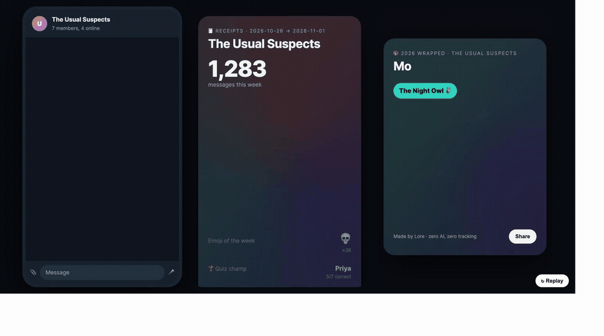

<p align="center">
  
</p>

<p align="center">
  <a href="https://deploy.workers.cloudflare.com/?url=https://github.com/mohitagw15856/lore"></a>
  &nbsp;
  
  
  
  
</p>

<h3 align="center">A Telegram bot that turns your group chat's own history into a daily game,<br>weekly Receipts, a yearly Wrapped, and time capsules.</h3>

<p align="center"><b>One tap to install. Nothing to pay for. Nothing to configure. No AI.</b><br>The group writes the content. Lore just remembers.</p>

<p align="center">
  
</p>

<p align="center"><sub>Mock-up of the real flow. The cards on the right are rendered by the bot from live data.</sub></p>

<br>


| | Every day | Every Monday | Every 31 Dec | Whenever |
|---|---|---|---|---|
| | 🧠 **Who Said It** | 🧾 **Receipts** | 🎁 **Wrapped** | ⏳ **Time capsule** |
| What | A real quote from *your* chat. Four names. Tap one. | Chattiest, fastest replier, ghost, night owl, emoji of the week, quiz champ. | A shareable card for the group and one for each member, with a persona. | Seal a message in DM. It opens in the group on the date you chose. |
| Why it's sticky | It's a Telegram quiz poll, so Telegram does the reveal. Streaks and a leaderboard. | People screenshot "Ghost: Sam (2d 4h)". | Spotify Wrapped, but for your friends. | Groups never remove a bot holding sealed letters. |

**The trick:** the content is funnier than anything a model could write, because it's your inside jokes. And it costs nothing to make, so it can be free forever.


Using the hosted bot: open **[t.me/lore_bot?startgroup=true](https://t.me/lore_bot?startgroup=true)**, pick a group, done.

Lore starts counting from that second. Never earlier. The first quiz posts the next morning at 9:00 (change it with `/settime 21`, set your offset with `/timezone +5:30`).

> Hosted bot not live yet? Deploy your own below. It takes about three minutes.


This is the whole trust story, so it's the headline, not the footnote.

- **Sees only what comes after it.** Telegram bots can't read history. Lore counts from the day it's added.
- **Raw text lives 30 days, then it's gone.** It's only kept so a quote can be picked for the quiz. Everything else is counts: messages per day, replies, emoji.
- **Remove the bot and the group is forgotten.** Instantly, every table.
- **`/forgetme`** deletes everything about you. In the group, or everywhere if you DM it.
- **No AI, no third parties, no ads, no analytics.** One Cloudflare Worker, one SQLite database, that's the stack.

`/privacy` in any group prints this.


| Command | Does |
|---|---|
| `/play` | Post a Who Said It quiz right now |
| `/leaderboard` | Points, win rate, 🔥 streaks |
| `/receipts` | This week's stats, with a shareable card link |
| `/wrapped` · `/wrapped 2025` | The year so far, or a past year |
| `/me` | Your personal Wrapped card and persona |
| `/capsule` | Seal a time capsule (continues in DM) |
| `/settime 21` | Hour the daily quiz posts, local time |
| `/timezone +5:30` | The group's UTC offset |
| `/pause` · `/resume` | Stop or restart the daily posts (counting continues) |
| `/privacy` | What is stored and for how long |
| `/forgetme` | Delete everything about you |


Lore is a single Cloudflare Worker with a D1 database and an hourly cron. It fits comfortably in the free tier for thousands of groups.

**Option A: the button.**

1. Talk to [@BotFather](https://t.me/BotFather): `/newbot`, copy the token. Then `/setprivacy` → **Disable** (so the bot can see group messages).
2. Click [Deploy to Cloudflare](https://deploy.workers.cloudflare.com/?url=https://github.com/mohitagw15856/lore). It creates the Worker and the D1 database.
3. In the Worker's settings add two secrets: `BOT_TOKEN` and `WEBHOOK_SECRET` (any long random string). Set the `BOT_NAME` variable to your bot's username.
4. Visit `https://<your-worker>.workers.dev/setup?secret=<WEBHOOK_SECRET>` once. It registers the webhook and the command menu and prints your install link.

**Option B: the terminal.**

```bash
git clone https://github.com/mohitagw15856/lore && cd lore
./scripts/setup.sh      # creates D1, applies migrations, asks for the token, deploys, registers the webhook
```

**Local dry run** (no Telegram account needed, a mock API answers every call):

```bash
npm install
cp .dev.vars.example .dev.vars            # TG_API_BASE=http://localhost:8798 is already set for the mock
npx wrangler d1 migrations apply lore --local
node scripts/mock-telegram.mjs &          # fake Telegram, logs every call
npx wrangler dev --port 8799 --test-scheduled
curl "localhost:8799/__scheduled?cron=0+*+*+*+*"   # fire the hourly tick by hand
```

```bash
npm test          # 17 unit tests on the pure logic and card renderers
npm run typecheck
npm run samples   # re-render docs/demo/*.html from sample data
```

### How it's built

```
src/
  index.ts     Worker entry: /webhook, /setup, /c/<token>/… cards, hourly cron
  bot.ts       update router: group commands, DM flow, membership changes
  ingest.ts    one message → member count, daily stats, emoji stats, 30-day raw text
  game.ts      pick a quote, post a quiz poll, score poll answers, leaderboard
  stats.ts     Receipts (a week), Wrapped (a year), per-member card + persona
  cards.ts     shareable HTML cards (pure renderers + route)
  capsule.ts   time capsules via a deep-linked DM flow
  cron.ts      per-group local-hour tick: quiz, Monday receipts, 31 Dec wrapped, purge
  logic.ts     pure functions, fully tested: quote filter, streaks, points, time math
migrations/    D1 schema. Raw text only in `messages`; everything else is counts.
```

Quizzes are native Telegram **quiz polls**: non-anonymous, with the correct option set, so Telegram shows the reveal and sends Lore a `poll_answer` for scoring. No custom keyboards, no callback spam.

### Roadmap

- [x] Who Said It, Receipts, Wrapped, personas, time capsules, privacy commands
- [ ] Card as PNG (Workers Browser Rendering) so `/wrapped` can post an image directly
- [ ] "Pro group" via Telegram Stars: unlimited history, custom card colours
- [ ] Milestone capsules: unlock when a member gets married / leaves / hits 10k messages
- [ ] Import an exported WhatsApp chat for a one-off Wrapped

### Inspired by

NextChat showed that a self-hostable wrapper with a deploy button can get 89k stars. Lore keeps the deploy button and drops the API key: the group is the content engine, so the marginal cost is zero and the install is one tap.

<p align="center"><sub>MIT · built by <a href="https://github.com/mohitagw15856">Mohit</a> · every message you send is a future quiz question</sub></p>
